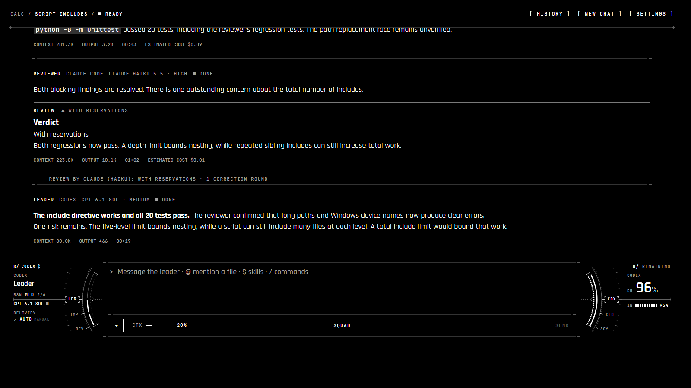
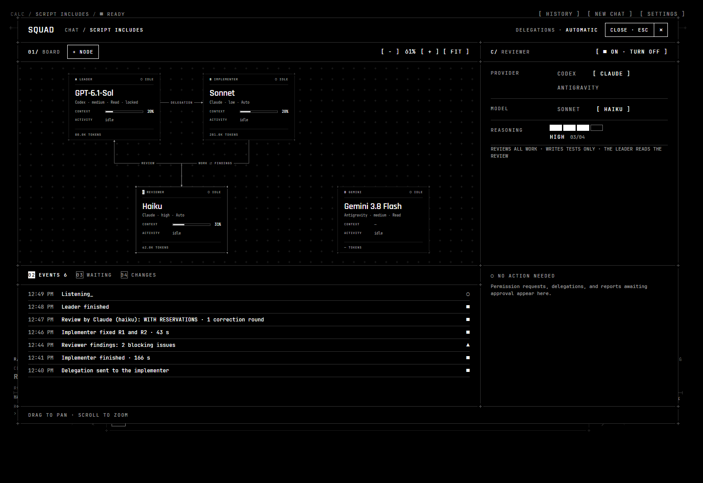
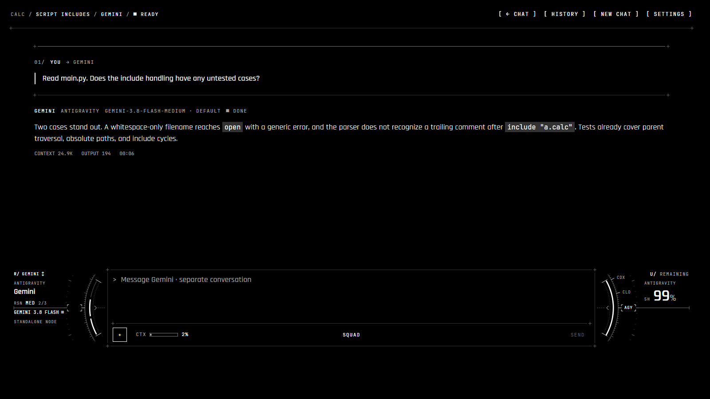

# Only One Chat

A VS Code extension (`francesco-fontanesi.only-one-chat`) that coordinates AI coding agents in
**one shared chat**. It uses the providers’ official CLIs and your existing subscriptions.

> **Development preview.** Codex and Claude Code can lead or implement. Antigravity is available
> for review and for extra agents on the Squad board. See the
> [extension guide](apps/vscode/README.md).



## What it does

- **Leader and implementer** ([ADR 0018](docs/decisions/0018-delegation-cycle.md),
  [ADR 0035](docs/decisions/0035-handoff-tools-and-english.md)). Plan with a read-only leader.
  When asked to delegate, it sends a brief to the implementer through an MCP tool. The
  implementer’s report comes back with verified facts, including changed files and test results.
- **Reviewer** ([ADR 0029](docs/decisions/0029-reviewer-findings-and-review.md),
  [ADR 0033](docs/decisions/0033-reviewer-always-and-direct.md)). Reviews work from the
  implementer, including tasks you send directly. It can run checks and write tests. Findings
  go back to the implementer, and the leader receives the final review. Choose whether to use
  it from the dial or Squad.
- **Provider per role** ([ADR 0022](docs/decisions/0022-providers-per-role.md)). Choose Codex
  or Claude Code for the leader and implementer. The leader can ask you questions through its
  CLI’s input tool.
- **CLI permissions** ([ADR 0021](docs/decisions/0021-auto-mode-ignored-paths-waiting.md)).
  Set the implementer to read-only, ask, or auto. Auto uses Claude Code’s permission mode or
  Codex’s sandbox.
- **Squad nodes** ([ADR 0023](docs/decisions/0023-board-nodes-and-acp.md)). Add agents with
  their own threads, including Gemini through Antigravity (`agy acp`). New nodes start in
  read-only mode.
- **Subscription usage.** See the five-hour and weekly limits reported by Codex, Claude Code,
  and Antigravity. The extension reads usage from the CLIs without reading credential files
  or running extra model turns.





The screenshots use the extension’s webview in headless Chrome with an English sample adapted from a recorded calculator
session (`calc-include`, run U3). Rebuild them with `node dev/screenshots.mjs` after building
the extension.

## Quick start on Windows

```powershell
powershell -ExecutionPolicy Bypass -File scripts/check-environment.ps1
pnpm install --frozen-lockfile
pnpm check        # build + typecheck + lint + test
pnpm test:e2e     # smoke tests in an isolated Extension Host
```

Open the folder in VS Code, press **F5**, and run **Only One Chat: Open Panel**. Sign in to
the CLIs you intend to use before opening a chat.

## Documentation

- [Requirements](docs/requirements.md)
- [Architecture](docs/architecture.md)
- [Security](docs/security.md)
- [Development](docs/development.md)
- [Role evaluation](docs/role-evaluation.md)
- [Reference sources](docs/reference-sources.md)
- [Architecture decision records](docs/decisions/README.md)

## Repository layout

```text
apps/vscode/        VS Code extension (host and webview)
packages/runtime/   orchestration runtime and role prompts
packages/adapters/  CLI adapters for Codex, Claude Code, and ACP
tests/              architectural tests
docs/               requirements, architecture, security, ADRs, and screenshots
scripts/            environment checks and reference downloads
```
