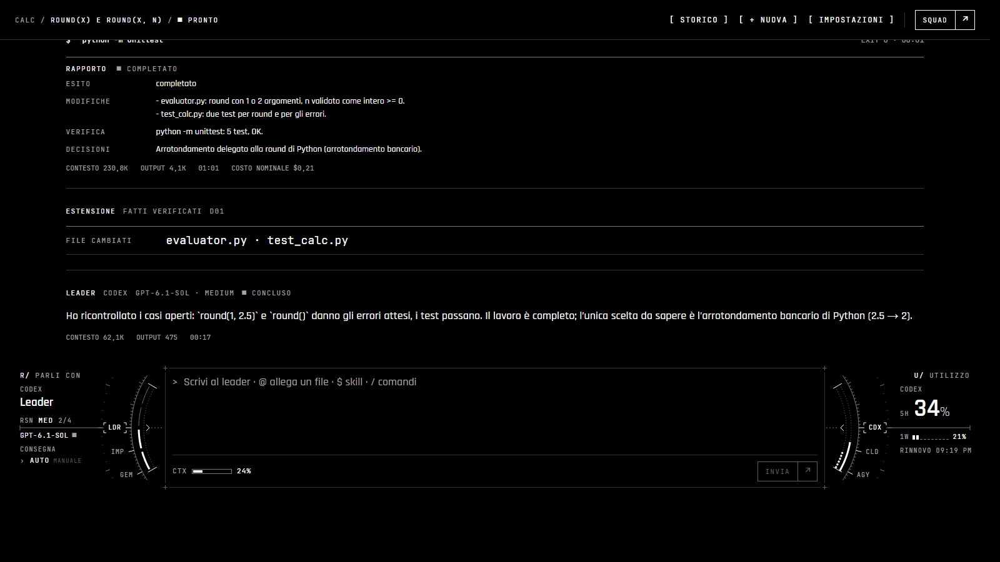
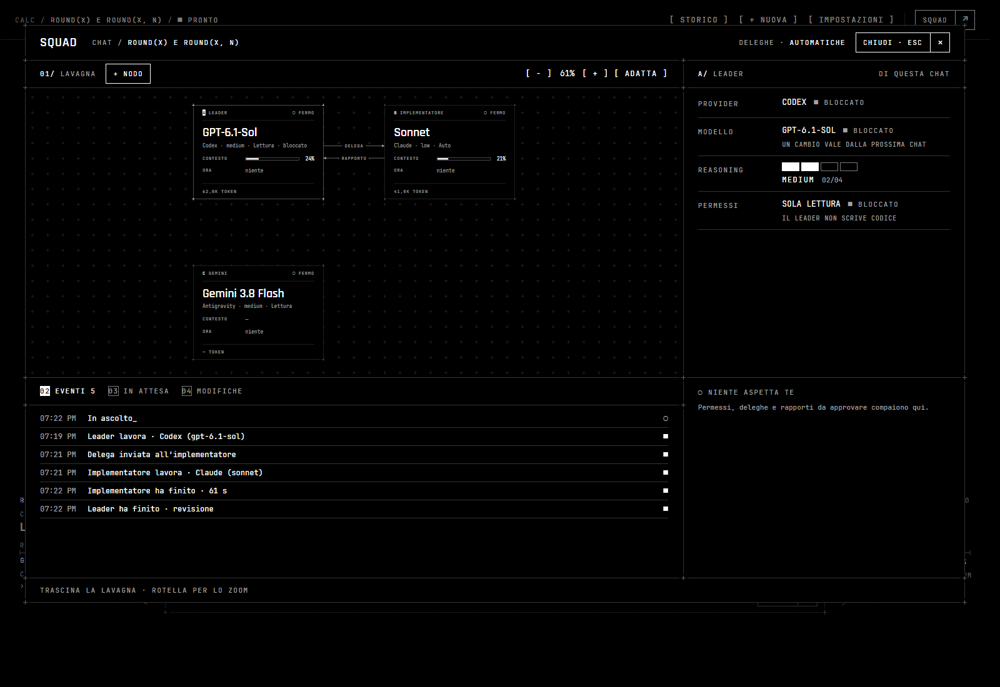
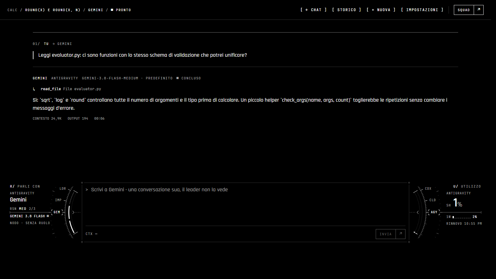

# Only One Chat

Estensione VS Code (`francesco-fontanesi.only-one-chat`) per coordinare più agenti AI di coding
attraverso **un'unica chat condivisa**. Usa i CLI ufficiali e gli abbonamenti esistenti, mai API
a pagamento.

> **Stato: anteprima di sviluppo.** Il ciclo leader → implementatore → revisione funziona dal
> vivo con Codex e Claude Code in entrambi i ruoli, e altri agenti si aggiungono come nodi
> (Antigravity tramite ACP). Il manuale d'uso è nel
> [README dell'estensione](apps/vscode/README.md).



## Cosa fa

- **Leader e implementatore** ([ADR 0018](docs/decisions/0018-delegation-cycle.md)):
  - ragioni e pianifichi con il leader, che non scrive mai codice;
  - quando glielo chiedi, scrive un brief che il runtime intercetta e consegna all'implementatore;
  - il rapporto torna al leader com'è, insieme ai fatti verificati dall'estensione (file
    cambiati, test rieseguiti).
- **Qualsiasi provider in qualsiasi ruolo** ([ADR 0022](docs/decisions/0022-providers-per-role.md)):
  Codex e Claude Code fanno da leader o da implementatore. Il leader ti fa domande con lo
  strumento del proprio CLI.
- **Permessi dei CLI stessi** ([ADR 0021](docs/decisions/0021-auto-mode-ignored-paths-waiting.md)):
  sola lettura, chiede prima di agire, oppure auto (la modalità auto di Claude Code, la sandbox
  di Codex). Mai `--dangerously-skip-permissions`.
- **Nodi sulla lavagna di Squad** ([ADR 0023](docs/decisions/0023-board-nodes-and-acp.md)):
  - agenti in più, anche Gemini tramite Antigravity (`agy acp`);
  - ognuno ha il suo thread: lo selezioni e gli scrivi;
  - partono in sola lettura.
- **Utilizzo degli abbonamenti:** finestre di 5 ore e settimanali di Codex, Claude e Antigravity,
  lette senza consumare quota e mai da file di credenziali.





Gli screenshot sono la webview vera, con dati di esempio presi da una prova sulla calcolatrice
di `sandbox/scenarios/calc`.

## Avvio rapido (Windows)

```powershell
powershell -ExecutionPolicy Bypass -File scripts/check-environment.ps1
pnpm install --frozen-lockfile
pnpm check        # build + typecheck + lint + test
pnpm test:e2e     # smoke test nell'Extension Host isolato
pnpm playground   # copia della calcolatrice dove provarla a mano
```

Poi apri la cartella in VS Code, premi **F5** e lancia **Only One Chat: Open Panel**. Servono
i CLI già autenticati che vuoi usare: `codex`, `claude`, ed eventualmente `agy` per i nodi.

## Documentazione

- [Requisiti](docs/requirements.md)
- [Architettura](docs/architecture.md)
- [Sicurezza](docs/security.md)
- [Sviluppo](docs/development.md)
- [Valutazione dei ruoli](docs/role-evaluation.md)
- [Sorgenti di riferimento](docs/reference-sources.md)
- [Decisioni (ADR)](docs/decisions/README.md)

## Struttura

```text
apps/vscode/        estensione VS Code (host + webview)
packages/runtime/   runtime di orchestrazione e prompt di ruolo (senza vscode)
packages/adapters/  adapter dei CLI: Codex, Claude Code, ACP (senza vscode)
tests/              test architetturali
docs/               requisiti, architettura, sicurezza, ADR, screenshot
scripts/            check-environment.ps1, fetch-references.ps1
references/         sorgenti di studio (non versionati)
```

## Licenza

[MIT](LICENSE), scelta provvisoria da confermare prima di una distribuzione pubblica.
