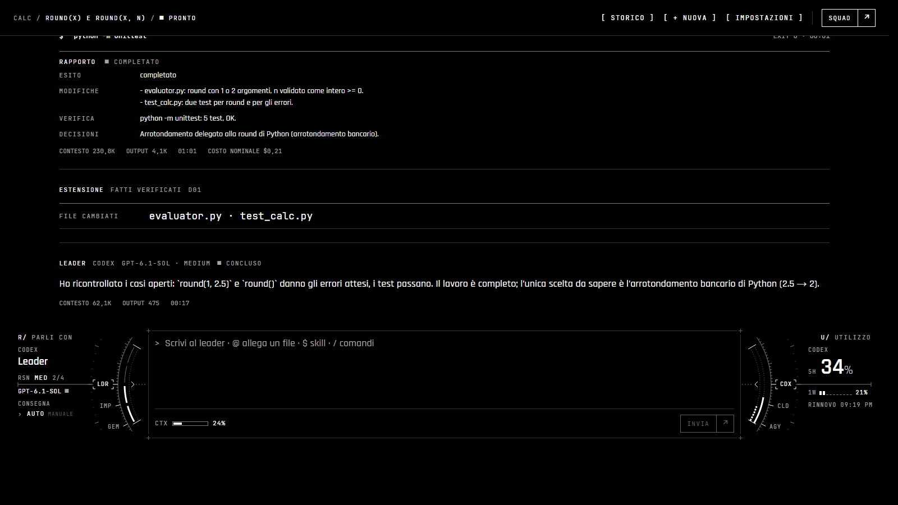
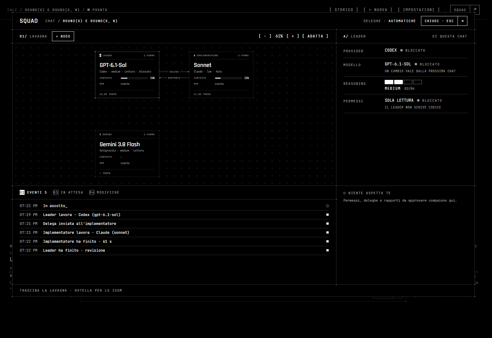
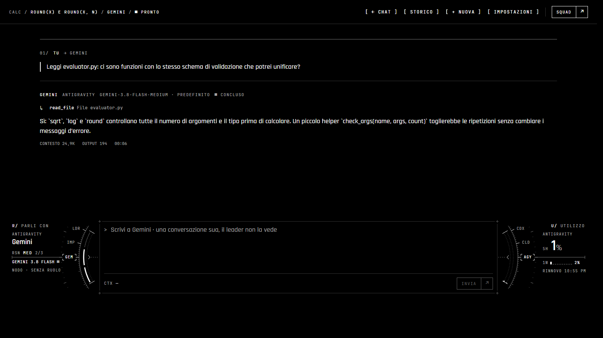

# Only One Chat

Development preview. One chat in VS Code with a **leader**, the model you reason with, which
works with an **implementer** on another subscription (ADR 0010 in the repository). Either role
runs on Codex or Claude Code (ADR 0022), and more agents can join on Squad's board as **nodes**,
Antigravity's Gemini among them (ADR 0023).

## How it works

You reason and plan with the leader (ADR 0018). It never writes code: its session is read-only,
though it reads the repository and runs commands to search and check. Every change goes to the
implementer.

- **The leader answers, explains and asks** what it needs to decide.
- **When you ask for the prompt or the work** ("genera il prompt", "procedi"), it writes a brief
  for the implementer (ADR 0020): Obiettivo, Contesto with `@path`, Vincoli, Criteri di
  accettazione, Confini, Fermati se. The brief never asks for a report: the implementer's own
  role prompt has its format, between `<<<RAPPORTO` and `RAPPORTO>>>` (Esito, Modifiche,
  Verifica, Decisioni, Bloccato su, Fuori ambito), and the thread shows it as a card.
- **How the brief reaches the implementer** is the delivery, in the leader's dial (CONSEGNA) or
  in the box:
  - **AUTO:** it goes at once;
  - **MANUALE:** it waits for you in place of the box, editable as free text, and the chat waits
    with it until you send or cancel it. A brief still waiting when the chat closes is kept with
    it and waits again when you reopen it.
- **The implementer's report reaches the leader as it is**, never edited, with the facts the
  extension verified (changed files, tests run again). The leader then tells you whether
  everything went well and what does not add up. With `onlyOneChat.leaderReview` set to
  `deferred` it reads them with your next message instead, one leader turn less.
- **While it works, the leader may ask you questions** (ADR 0019, 0022), with Codex's or
  Claude Code's own tool: they take the box's
  place, one at a time, as a choice among its options (with "Altro" for your own words) or as a
  free answer, and its turn goes on with your answers. The implementer does not ask: a decision
  missing from its brief stops it, and it says so in its report.
- **For a small change, write to the implementer directly:** it is the cheapest way, and the
  leader reads that report with your next message.

## The chat

The chat opens in an editor tab, which you can move and resize; the layout follows its width.

- **The bar:** the folder and the chat's title, its state (PRONTO, IN CORSO, ASPETTA TE, NON
  PRONTO), STORICO (the chats of this folder), + NUOVA, IMPOSTAZIONI and SQUAD.
- **The thread:** one column; each message opens with a line saying who wrote it, with which
  model, and its state, and COPIA (and ↺ RIPRISTINA QUI on yours) at hand. A turn shows what the
  agent does as it happens (ADR 0019): its intermediate messages, its reasoning (Codex's summary;
  with Claude only that it reasoned), each command with its exit code, time and output, each
  changed file with its diff, the turn's plan and its other tools; a step opens on a click; its context, output, time and, for
  Claude, nominal cost close it. Delegations (D01, D02) are one line, their brief one click away; the
  leader's text leaves the brief out. A `@path` that exists in the folder opens the file; then
  the facts the extension verified and the changes to review.
- **The dock, at the bottom:** what waits for you takes its place — a permission (keys 1, 2, 3;
  Esc denies), a brief held by the manual delivery, editable — else the box you write in. It
  grows with the text up to about a third of the panel, then scrolls. Under the text, one line:
  each choice shows only what is chosen, with one square per option (point at a square to see
  that option, click it to choose, or click the name to move to the next).
  - **A — LEADER / IMPLEMENTATORE:** who receives it, one per message. Writing to the implementer
    directly is the cheapest way when you already know what to ask; the leader reads that report
    with your next message;
  - **CONSEGNA:** for the leader, whether its briefs go at once (AUTO) or wait for you
    (MANUALE), when the dials are not shown;
  - **CTX:** how full the session of the agent you write to is, after its latest turn;
  - `@` in the text attaches a file or a folder (see below); `$` names a skill of the CLI you
    write to, which it invokes in its own way (Claude may also choose skills by itself, as
    Codex does); `/` at the start of the text lists
    the commands: `/impl`, `/leader`, `/allega`, `/skill`, `/nuova` (or
    `/ferma` while it works), `/squad`, `/impostazioni`. Any other text that starts with `/`
    reaches the agent as text: the CLIs' own commands (`/clear`, `/plan`…) never run from the
    chat.
- **On a wide panel,** two dials sit beside the box. On the left, who you talk to: click LDR,
  IMP or a node, or the outer ring. Its sight sets the reasoning (drag, click a segment or use the wheel);
  the level reads above the middle line. Under it, for the leader the delivery, AUTO or MANUALE; for the implementer
  its model (↕ moves to the next one) and **HANDOFF**, a new session of the same model that starts
  from a handoff the current one writes; a node has only its model and reasoning there. On the
  right the usage of the provider of who you talk to (Codex, Claude, Antigravity): 5 hours and
  weekly, and when the window resets.
- **Enter** sends, **Shift+Enter** starts a new line (the other way round in the settings).

A brief written in the ChatGPT web app (it starts with `<<<OOC-BRIEF`) can be pasted into the
chat. The leader does not rewrite it: it adds notes that bring it up to date, and it goes to
the implementer at once, also with the manual delivery, since you reviewed it in ChatGPT.

## The Squad panel

SQUAD opens a panel over the chat: a board you can drag and zoom, with the leader and the
implementer as blocks (model, state, context, what each is doing) and the delegations and reports
that pass between them; the events, what waits for you, the changes, and gauges for the context
and the usage of the subscriptions. Select an agent to
change, in the side column:

- the model, among those the CLIs offer, read from Codex and Claude Code themselves with no turn
  and no quota. The leader's model stays the one the chat began with; another applies from the
  next chat;
- the reasoning, among the levels that model supports, and the permissions: from the role's next
  turn, in the same session;
- another provider: from the next chat, since a chat keeps its providers.

Nothing changes the roles automatically.

### Nodes

**+ NODO** adds an agent to the board besides the two roles (ADR 0023): Codex, Claude Code or
Antigravity, whose CLI speaks the Agent Client Protocol (`agy acp`).

- **Its own thread:** select it, on the board or on the left dial, and the chat shows its
  conversation; the box writes to it. ← CHAT goes back. A node does not see the leader's thread,
  nor the leader its; it has no delegation and no review.
- **Read-only when added:** it reads and answers. Its permissions, model, reasoning and name
  change in Squad; it is kept in the folder's settings (`onlyOneChat.nodes`), and its thread
  with the chat.
- **On Antigravity,** the model's levels are its reasoning (Gemini 3.8 Flash: low, medium, high).
  Read-only, every permission it asks for is denied by its role; Chiede asks you; Auto is
  Antigravity's own auto mode.

Some starting points:

| Way of working                                     | Leader                                                              | Implementer                                 |
| -------------------------------------------------- | ------------------------------------------------------------------- | ------------------------------------------- |
| You reason in the extension                        | a strong model with high reasoning, e.g. Sol 6.1 high               | an efficient one, e.g. Sonnet low or medium |
| You reason in the ChatGPT web app and paste briefs | the same leader with low reasoning: it only forwards and adds notes | Sonnet medium                               |
| Small, well-defined tasks                          | low or medium                                                       | low                                         |

- Reasoning matters most where decisions are made: in the conversation, not in the forwarding
  of a brief that is already reasoned.
- In our tests the implementer weighs more than the leader: an efficient implementer in a fresh
  session costs less than a strong model doing everything in one long chat.

## Usage of the subscriptions

The Squad panel shows each subscription's 5-hour and weekly windows.

- **Codex** is read from Codex itself, without using quota: when the chat opens, every 2 minutes
  while it is in view, and after each turn.
- **Claude** reports its windows only when a turn starts, so the panel shows the last value seen.
- **Antigravity** is read with `agy -p /quota`, which agy answers by itself with no turn and no
  quota, while a node uses it: every 2 minutes and after each of its turns. Its models share
  limits by group; the dial shows Gemini's, its tooltip every group's.

Nothing is read from credential files or session files.

## Settings

IMPOSTAZIONI in the chat's bar (or "Only One Chat: Settings")
opens a page with all the settings, grouped: roles, delegations, your own instructions per role,
sub-agents, permissions and unsaved files, the composer, notifications, the CLIs.

- They are VS Code's own settings: the page says whether a value comes from the default, your
  user settings or the folder's, and SALVA PER chooses where it writes.
- CLI paths, allowed commands, the verify command and the instructions per role are user
  settings only: a folder's settings cannot change them.

## Files and context

- **`@` in the box** (or @ FILE) lists the folder's files and folders; pick one with the arrows
  and Enter: it becomes an attachment above the text. `@` is for files only. **Ctrl+Alt+K** in the editor (or "Add File or
  Selection to Chat" in its context menu) attaches the open file, or the selected lines as
  `file#L10-20`.
- **The agents receive paths**, and read the files themselves: your leader's context does not
  fill with files. Selected lines are copied into the message when they are few (up to 80).
- **CTX** above the text tells how full the session of the agent you write to is, after its
  latest turn; the Squad panel shows it for both roles.

## Reviewing and undoing changes

- **Before each of your messages** the extension records the folder's files in its own storage
  (no git involved).
- **After the message** a MODIFICHE card lists each changed file with the lines added and
  removed. Click a file for VS Code's diff; ACCETTA keeps it, RIFIUTA puts it back as it was.
- **"↺ ripristina qui"** on one of your messages brings the folder back to before it.
- **The conversation is not rewound:** the agents are told, with your next message, which
  files were put back.
- **Not covered:** files over 2 MB, the excluded folders (`.git`, `node_modules`, …), and what a
  command does outside the folder.

## Chats are kept

- **Each chat of the folder is saved** in the extension's workspace storage, together with the
  ids of the agents' own sessions.
- **When you open the panel again**, the most recent chat comes back, and the leader and the
  implementer continue their sessions (`--resume` for Claude, `thread/resume` for Codex).
  Reports of the implementer the leader had not read yet reach it with your next message.
- **Earlier chats** are in STORICO; + NUOVA starts an empty one.
- **What was running or waiting** when the chat was closed is shown as interrupted.

## Scope and safety

- The agents work only in the folder open in VS Code, once it is trusted (Workspace Trust).
- The first request asks for your consent.
- Claude runs the programs in `onlyOneChat.allowedCommands` without asking; Codex writes inside
  the folder, without network.
- **The leader is read-only** (ADR 0018): Codex in its read-only sandbox, never asking to leave
  it; Claude with its read tools and only the commands Claude Code counts as read-only.
- **The implementer's permission level**, set in `onlyOneChat.implementer.permission`:
  - `read-only`: no file changes, no commands that write;
  - `ask`: asks you before acting. Codex asks before any command it does not know to be safe,
    Claude before every edit and command;
  - `auto`: acts inside the folder. For Claude this is Claude Code's own auto mode (ADR 0021):
    its classifier decides what would otherwise ask, as in the Claude Code extension. Where
    auto mode is not available (plan, model), Claude says so in the chat and works in default
    mode. `bypassPermissions` is never used.
- **The level can change during the chat** from the left dial (PERMESSI: Legge · Chiede · Auto)
  or from Squad; it applies from the implementer's next turn.
- **When an agent asks**, a PERMESSO card appears in the chat: once, for the session (the same
  command or file only), or no. Stopping the chat declines what is still waiting.
- **What waits for you** (permissions, delegations to send, questions) is counted on the SQUAD
  button and listed in Squad, where each can be answered. A short notice above the composer
  says when a new one arrives; click it to open Squad.
- **`onlyOneChat.ignoredPaths`** leaves paths out of the verified facts, the checkpoints and the
  changes card, written as in a `.gitignore` (for example `graft/` for a tool's cache).

License: MIT.
